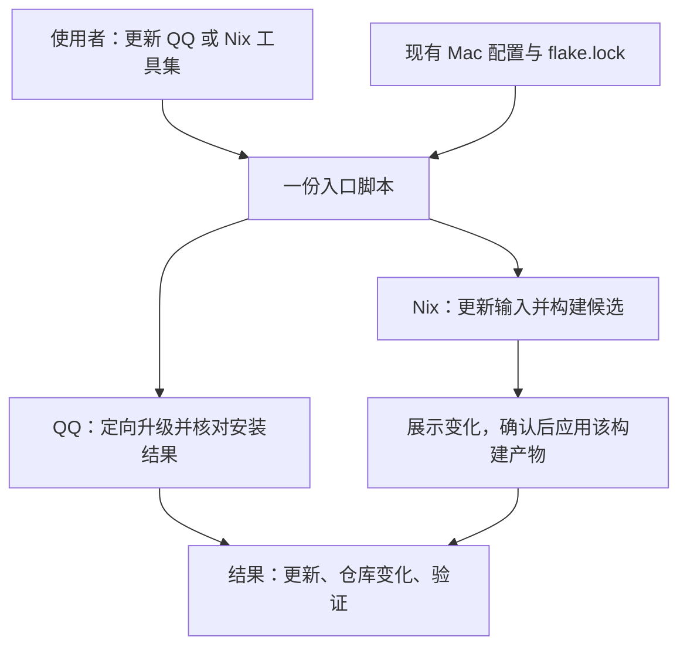

# 主工作站管理

本仓库以 macOS 日常使用与换机恢复为目标。维护者通过少量明确动作更新软件、保存认可的配置；换机以仓库当前内容和可取回的外部材料为起点。Nix、Homebrew 与原生应用分别承担实际有收益的职责，具体工具取舍仍按资源决定。

当前运行环境是实际状态的唯一事实来源。仓库保存维护者选定的稳定声明和输入，明确应用时写入什么；声明、generation 与现场并不天然一致。决定见 [ADR-0011](../adr/0011-declaration-led-workstation-management.md)，术语见 [CONTEXT.md](../../CONTEXT.md)。

本轮重构从已经入仓的内容继续维护，新增内容按明确需求保存，不重新盘点或补齐整台机器。未保存的临时配置修改可以被受管声明覆盖，不为保全它们增加自动捕获、快照台账或同步流程。既有安装来源也可以复审，特别是曾为更新方便而迁出的软件；分别检查安装、更新与配置应用的收益，不把历史迁入或迁出当作最终答案。

## 维护入口的调整方向

本节是待实现设计，只讨论日常更新。当前可执行方式仍见[日常 Nix 维护](../runbooks/daily-nix-maintenance.md)，仓库尚无 `workstation` 命令。

第一版使用一份 Bash 脚本 `bin/workstation`，内部保留 Homebrew 和 Nix 两条执行路径。先不拆多个脚本，不新增软件清单。使用者记住“更新什么”，脚本负责找到已有定义、调用工具和说明结果。

### 使用者的两个动作

下面是拟定的使用方式，当前不能执行：

```fish
./bin/workstation update qq
```

⬆️ 更新声明中的 QQ；入口核实 Homebrew 安装来源，刷新软件目录，定向升级并核对结果。

```fish
./bin/workstation update nix
```

🧰 更新 Mac 的 Nix 工具集；默认只更新 `nixpkgs-darwin`，构建后展示变化，确认再应用整份 Mac 配置。

这里的 `nix` 是工具集更新入口，不是单独更新 Nix/Lix 程序。它不默认更新 Linux 输入、nix-darwin、Home Manager 或固定来源；这些来源有实际更新需求时再单独处理。输入选择与最终包变化是两件事：更新 `nixpkgs-darwin` 仍可能影响多个软件和依赖，不能伪装成单软件更新。



### 脚本内部完成什么

| 环节 | QQ 路径 | Nix 工具集路径 |
| --- | --- | --- |
| 确认对象 | 从当前 Mac 配置求值得到已声明 cask，核实本机安装；未声明或未安装时停止，不顺便安装 | 确认目标是 `macbook`、输入是 `nixpkgs-darwin`；检查会混入候选的已有配置或 lock 改动 |
| 准备更新 | 刷新 Homebrew 目录，用定向升级预览检查实际动作 | 若有明确要保留的现场配置修改，先保存到声明；再更新所选输入、构建候选并展示包变化，此时系统尚未应用 |
| 执行 | 调用定向 cask 升级；不用强制重装，不顺便升级其他应用 | 确认整份配置的影响后，由 nh 应用刚才审阅的构建产物；若源码或 lock 中途改变，重新构建并审阅 |
| 收尾 | 核对安装元数据；定义仍是“安装 QQ”，通常没有仓库文件变化 | 保留本次 lock 变化，核对实际功能；分别说明 lock 已写入、是否已提交、是否已应用 |

实现复用本机现有工具：Homebrew 的定向 `upgrade --cask` 与 `--dry-run`，以及 nh 的定向输入更新、构建、差异展示和应用。Homebrew 刷新的是软件目录，不等于升级全部应用；定向升级仍可能涉及必要依赖或要求退出目标应用。脚本发现动作超出目标范围时应先说明，不能把普通 QQ 更新隐式扩大为整机激活。

现有 Software、Host 与 `flake.lock` 继续承担定义职责。入口读取求值结果，不靠搜索文件文字推断来源，不另建注册表。第一版不自动推断任意 Nix 软件来自哪个输入；没有已知更新路径时，说明未支持的对象并停止。

“仓库已保存”必须说清具体状态。写入 `flake.lock` 不等于 Git 已提交。收尾方式待维护者选择：成功应用后自动本地提交本次 lock 变化，或保留差异供手动审阅提交；流程按所选方式实现，不暗加自动提交。没有定义变化时，不制造文件变化或空提交。

### 什么时候需要使用者处理

正常路径不要求手动串联底层命令。只有实际需要判断或人工操作时才停下：来源无法确认、已有仓库改动会混入更新、实际范围超出所选目标，以及应用退出或系统密码。Nix 整机应用前保留一次范围确认；包差异不覆盖所有配置写入。常规应用不强制逐字段比对或备份未保存的偏好，具体写入行为仍以所选模块为准。

失败时保留工具的关键原因，并报告已经完成的步骤。例如构建失败时显示“输入已更新；构建失败；系统未应用；lock 尚未提交”，不能笼统显示“更新失败”或自动撤销用户的工作。取消应用也不能声称 lock 没有变化。工具报告安装成功，仅证明安装层面的结果，应用能否正常使用需单独核实。

### 第一版如何验收

实现时从 QQ 路径开始，再接入 Nix 工具集路径；均通过同一入口验证：

1. 更新 QQ 只调用定向路径，不触发 nh，不修改本来无需变化的定义；已是当前版本时正常结束。
2. 未声明、未安装或来源无法确认的对象，在升级前停止，明确原因。
3. Nix 只更新选定输入，确认前不激活，应用已审阅的构建产物；候选内容变化后必须重新构建并审阅。
4. 失败或取消后准确显示 lock、构建和应用状态，保留无关文件与已暂存的工作。
5. 真实验收分别检查 QQ 能正常启动、Nix 更新涉及的工具能完成实际动作；模拟调用与构建通过不等于完成这些验收。

## 日常使用与保存

可以先在 Mac 安装、试用和调整，再把认可且适合复用的设置、快捷键、任务保存为 Nix 版本。选择一个 Software 不等于接管它的全部配置和数据。每项声明必须按实际机制区分安装需求、包版本、持续管理字段和仅初始化材料。

Ghostty 与 VS Code 的 Mac 安装需求分别由现有 Homebrew cask `ghostty`、`visual-studio-code` 声明保存，应用仍位于 `/Applications/Ghostty.app` 和 `/Applications/Visual Studio Code.app`，通过原生渠道独立更新；当前 Homebrew 激活不升级已有包。Home Manager 的配置与 CLI 接线保持原有职责。

WezTerm 是低频使用的兼容终端，保留 Nix 安装与现有社区配置模块，版本由 `flake.lock` 中的 `nixpkgs-darwin` 输入锁定，关闭应用更新提示，不单独追新。更新该包集时，WezTerm 仍可能随候选一起变化；是否接受通过同一份候选差异判断。

LocalSend 的 Mac 安装和升级由 Homebrew cask `localsend` 负责；Linux 保留 Nix 包与既有防火墙规则。Pages、Keynote、Numbers、GarageBand 按维护者选择移出安装声明，交由系统或 App Store 处理，缺失不形成补录任务。当前 Homebrew `cleanup = "none"`，移除声明不会自动卸载现场应用。

Obsidian 的 Mac 安装需求由 Homebrew cask `obsidian` 保存，日常更新由应用处理，Electron 安装器通过 Homebrew 按需升级。官方 CLI 由 cask 提供，使用前在应用内开启命令行界面；Home Manager 不再提供旧的图形程序链接。笔记库、插件、主题、偏好与账号由 Obsidian 管理，Linux 继续使用 Nix 包。

长期软件优先使用社区 Nix 模块和 nh，允许合理版本滞后；实际阻碍可以支持原生迁移。迁出后删除无人使用的固定包与更新器，保留仍有用途的配置和集成。当前 Lix、nix-darwin、集成 Home Manager 与 Darwin rolling/Linux release 都可按真实需求复审，不预设永久绑定。

日常入口见[日常 Nix 维护](../runbooks/daily-nix-maintenance.md)。按实际操作需要增加包装命令，复用 Git/Nix/nh，减少重复输入；不另造声明或恢复系统。

## 写入边界与偏移

外部可写配置默认不建立自有同步或合并引擎。按资源选择仅在缺失时初始化、每次激活整份覆盖，或使用社区模块合并声明。具体机制、额外字段处理和删除语义写在最近的 Software 或 runbook，不建立全局矩阵。

偏移只涉及已声明且持续管理的字段。用户新增的未声明设置、账号、会话和数据不是声明缺陷，也不形成自动捕获任务。应用会重新执行所选配置的激活动作；只有明确想保留的现场修改才先保存到声明，其余未保存的受管字段修改可以被覆盖。常规应用不增加逐字段比对或强制私有备份；发现差异本身不授权整机激活。

Zed 使用 Home Manager 的可写合并，声明字段在每次激活时重新应用，额外字段保留；删除声明不会删除现场遗留字段。具体写入限制与处理方式见 [Zed 手册](../runbooks/update-zed-preview.md)。

VS Code 的 Mac 默认用户 `settings.json` 使用持续整份覆盖：每次激活写入仓库基线，文件仍可直接编辑；该文件内未保存的修改和额外字段会被覆盖。基线使用 `update.mode = default`，扩展、账号、keybindings 与其他 profiles 不自动纳管。具体范围与验收见 [macOS 环境恢复与回滚](../runbooks/restore-macos-environment.md)。

## 选择复用

维护者选择软件、配置和目标机器，验证目标实际行为。重点是相同的使用意图，允许平台适配和软件版本差异；精确版本一致只在明确要求时核实。

macOS 的 Home Manager 集成在 nix-darwin output 中，整机应用可能同时涉及系统设置和 Homebrew/MAS。修改单个 Software 不证明激活只影响该软件，也不授权整机动作。沿用 [AGENTS.md](../../AGENTS.md) 的目标、动作、停止条件与恢复边界。

每台机器的登录态、用户内容和应用数据独立；数据同步属于单独需求，优先采用软件现有能力。不能保留未选中状态时，应说明限制并调整方案。

## 私有记录与恢复

Macwarden 独立保存维护者选定的私有现场证据和历史，其模型、Skills、存储定位与触发合同由该项目维护。本仓库不复制这些实现，也不增加普通工作的自动捕获或跨 Agent 管理规则。历史记录只能证明对应时间与范围，不能取代当前读回。

配置恢复使用已保存且可获取的声明与产物；未保存的现场变化不在保证内。Git 回退与运行环境回滚是不同动作，generation 不保证撤销 defaults、外部安装器和可写配置的全部副作用。应用数据依赖自己的备份与恢复流程，不增加高于 Nix 的恢复编排层。
