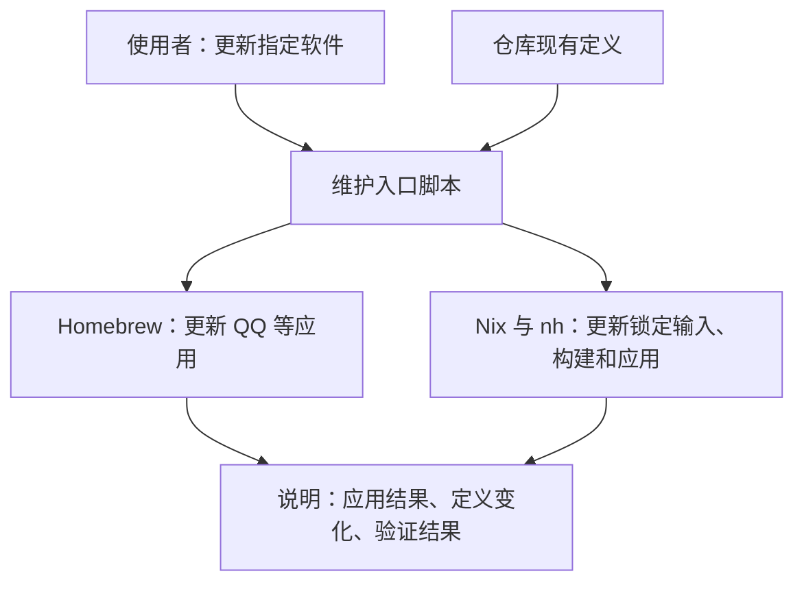

# 主工作站管理

本仓库以 macOS 日常使用与换机恢复为目标。维护者通过少量明确动作更新软件、保存认可的配置；换机以仓库当前内容和可取回的外部材料为起点。Nix、Homebrew 与原生应用分别承担实际有收益的职责，具体工具取舍仍按资源决定。

当前运行环境是实际状态的唯一事实来源。仓库保存维护者选定的稳定声明和输入，明确应用时写入什么；声明、generation 与现场并不天然一致。决定见 [ADR-0011](../adr/0011-declaration-led-workstation-management.md)，术语见 [CONTEXT.md](../../CONTEXT.md)。

## 维护入口的调整方向

本节是待实现设计。当前可执行方式仍见[日常 Nix 维护](../runbooks/daily-nix-maintenance.md)，仓库尚无 `workstation` 命令。

使用者只需表达要维护的对象；入口脚本负责读取现有定义、确定实际影响范围、调用更新工具、保存相关变化并说明结果。以下是职责图，不是新的软件声明格式：

实现分为三处：

1. **一个使用入口**：接收软件名称和维护动作，给出简短结果；正常路径不要求使用者手动串联底层命令。
2. **按实际工具分开的执行脚本**：Homebrew 与 Nix 是已有的两条路径；影响范围、验证和失败处理留在相应实现。Nix 更新若涉及多个软件，入口明确展示实际范围。
3. **现有定义文件**：安装项、配置素材和锁文件继续保存原本承担的内容。脚本读取并更新这些文件，不另建软件总表、状态数据库或更新历史台账。

### 两个例子：更新后仓库究竟保存什么

| 当前路径 | 更新动作 | 仓库结果 | 换机含义 |
| --- | --- | --- | --- |
| QQ 的 Homebrew 安装项 | 更新本机 QQ，核实实际结果 | 仍然保存“安装 QQ”；软件名称未变时通常无文件变化 | 安装恢复时 Homebrew 提供的版本，不承诺重装本次版本 |
| 锁定输入中的 Nix 工具 | 更新所选输入，用同一候选构建和应用 | 保存更新后的 `flake.lock`；可能同时影响多个软件 | 使用当前锁定输入，仍依赖源码或构建产物可获取 |

这两行描述已有定义的语义，不代表已经决定所有软件的最终版本策略。如果 QQ 也需要固定当前认可版本，必须另行设计版本定义及安装材料的获取方式；仅增加包装脚本不能带来这个保证。

一次维护分别报告三个结果：应用是否完成、必要的定义变化是否保存、验证完成到什么程度。应用更新成功但保存失败时，明确说明部分完成；定义无需变化时说明原因，不制造无意义的提交。脚本保留无关工作，不把整机现场自动当作认可清单。

换机使用同一份当前定义。登录、系统授权、私有备份取回等步骤仍按各自恢复方法执行；本设计不承诺一次命令完成所有外部状态恢复。

## 日常使用与保存

可以先在 Mac 安装、试用和调整，再把认可且适合复用的设置、快捷键、任务保存为 Nix 版本。选择一个 Software 不等于接管它的全部配置和数据。每项声明必须按实际机制区分安装需求、包版本、持续管理字段和仅初始化材料。

长期软件优先使用社区 Nix 模块和 nh，允许合理版本滞后；实际阻碍可以支持原生迁移。迁出后删除无人使用的固定包与更新器，保留仍有用途的配置和集成。当前 Lix、nix-darwin、集成 Home Manager 与 Darwin rolling/Linux release 都可按真实需求复审，不预设永久绑定。

日常入口见[日常 Nix 维护](../runbooks/daily-nix-maintenance.md)。按实际操作需要增加包装命令，复用 Git/Nix/nh，减少重复输入；不另造声明或恢复系统。

## 写入边界与偏移

外部可写配置默认不建立自有同步或合并引擎。可以仅在缺失时初始化；明确选择的社区模块也可以在每次激活合并声明。具体机制、额外字段处理和删除语义写在最近的 Software 或 runbook，不建立全局矩阵。

偏移只涉及已声明且持续管理的字段。用户新增的未声明设置、账号、会话和数据不是声明缺陷，也不形成自动捕获任务。应用会重新执行所选配置的激活动作：先核实相关现场，把想保留的受管字段修改保存到声明，再审阅并应用。放弃现场修改同样应明确知情，发现差异不授权自动覆盖或整机激活。

Zed 使用 Home Manager 的可写合并，声明字段在每次激活时重新应用，额外字段保留；删除声明不会删除现场遗留字段。解析失败、注释丢失和备份要求见 [Zed 手册](../runbooks/update-zed-preview.md)。

## 选择复用

维护者选择软件、配置和目标机器，验证目标实际行为。重点是相同的使用意图，允许平台适配和软件版本差异；精确版本一致只在明确要求时核实。

macOS 的 Home Manager 集成在 nix-darwin output 中，整机应用可能同时涉及系统设置和 Homebrew/MAS。修改单个 Software 不证明激活只影响该软件，也不授权整机动作。沿用 [AGENTS.md](../../AGENTS.md) 的目标、动作、停止条件与恢复边界。

每台机器的登录态、用户内容和应用数据独立；数据同步属于单独需求，优先采用软件现有能力。不能保留未选中状态时，应说明限制并调整方案。

## 私有记录与恢复

Macwarden 独立保存维护者选定的私有现场证据和历史，其模型、Skills、存储定位与触发合同由该项目维护。本仓库不复制这些实现，也不增加普通工作的自动捕获或跨 Agent 管理规则。历史记录只能证明对应时间与范围，不能取代当前读回。

配置恢复使用已保存且可获取的声明与产物；未保存的现场变化不在保证内。Git 回退与运行环境回滚是不同动作，generation 不保证撤销 defaults、外部安装器和可写配置的全部副作用。应用数据依赖自己的备份与恢复流程，不增加高于 Nix 的恢复编排层。
